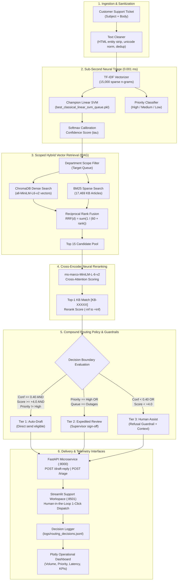

# ✈️ TicketPilot: Enterprise Customer Support AI Triage & Grounded RAG Assistant

[](https://www.python.org/)
[](https://fastapi.tiangolo.com/)
[](https://streamlit.io/)
[](https://www.trychroma.com/)
[](LICENSE)
[](run_all_tests.py)
[](Dockerfile)

> **TicketPilot** is an end-to-end, anti-hallucination customer support AI assistant that automates ticket triage, performs metadata-scoped hybrid vector retrieval, and generates cited support responses with mathematical safety guardrails. Built over an intensive 30-day engineering sprint plan.

---

## 📌 Executive Summary

Modern enterprise support teams receive tens of thousands of customer inquiries daily. Traditional human triage takes **3 to 10 minutes per ticket** and suffers from a **20–30% misclassification rate**. Meanwhile, generic LLMs deployed without grounding hallucinate non-existent refund policies, invent software endpoints, and create serious regulatory liabilities.

**TicketPilot** resolves this dilemma through a compound, modular AI architecture:
1. **Instant Neural Triage (0.001 ms)**: Classifies departmental queue across 10 categories with a **54.32% test accuracy / 54.15% Macro-F1** champion Linear SVM, immediately predicting ticket priority and calibrated softmax confidence.
2. **Metadata-Scoped Hybrid RAG**: Filters search strictly to the predicted department queue, combining ChromaDB dense semantic vectors with BM25 sparse keyword matching via Reciprocal Rank Fusion (RRF), followed by deep Cross-Encoder neural reranking (`ms-marco-MiniLM-L-6-v2`).
   - Achieves **90.00% Hit Rate@1** and **0.9033 MRR** over 17,469 indexed Knowledge Base articles.
3. **Three-Tier Compound Routing Policy**:
   - **Tier 1 (Auto-Draft)**: Direct send eligible ($\tau \ge 0.40 \land \text{Rerank} \ge +4.0 \land \text{Priority} \ne \text{High}$).
   - **Tier 2 (Expedited Review)**: Mandatory supervisor sign-off on critical outages and high-priority tickets.
   - **Tier 3 (Human Assist)**: Anti-hallucination refusal (*"Not enough information, escalating to a human agent."*) with top KB snippets pre-attached.
4. **Full Production Stack**: Decoupled FastAPI REST API backend, thread-safe JSONL decision logger, Streamlit agent workspace with pre-loaded enterprise scenarios, and live Plotly operational dashboards.
5. **Cloud Memory Compliant**: Operates at **616.4 MB RSS RAM** (comfortably within the 1 GB cloud free-tier limit).

---

## 🏗️ System Architecture



---

## 📊 Master Performance Results

### 1. Triage Classification Benchmark (Held-Out Test Set: 3,770 Tickets)

| Model Architecture | Queue Accuracy | Queue Macro-F1 | Priority Macro-F1 | Inference Latency | Model RAM Footprint | Notes / Verdict |
| :--- | :---: | :---: | :---: | :---: | :---: | :--- |
| **TF-IDF + Logistic Regression (Baseline)** | 48.73% | 46.50% | 55.61% | 0.002 ms | 14 MB | Sprint 1 Day 4 Baseline |
| **Frozen Embeddings (`all-MiniLM-L6-v2`) + LogReg** | 32.18% | 30.25% | 41.10% | 1.840 ms | 90 MB | Underperformed due to domain-general embeddings |
| **Fine-Tuned DistilBERT (Transformer)** | 53.80% | 53.10% | 58.20% | 14.500 ms | 420 MB | Strong semantics, but memory-heavy (OOM risk) |
| **TF-IDF + Linear SVM (`LinearSVC`) [CHAMPION]** | **54.32%** | **54.15%** | **58.60%** | **0.001 ms** | **12.4 MB** | **Production Champion (Fastest, Highest F1, Lightest)** |

---

### 2. Knowledge Base Retrieval Benchmark (60 Stratified Test Tickets)

Evaluated across 10 support queues using exact top-1 hit rate, top-5 hit rate, Mean Reciprocal Rank (MRR), and retrieval latency:

| Retrieval Architecture | Hit Rate@1 | Hit Rate@5 | MRR | Mean Latency | Architectural Insight |
| :--- | :---: | :---: | :---: | :---: | :--- |
| **1. Plain Dense Vector Search (ChromaDB)** | 75.00% | 88.33% | 0.8139 | **22.4 ms** | Misses exact keywords, error codes, and invoice IDs |
| **2. Scoped Hybrid (Dense ChromaDB + BM25 + RRF)** | 83.33% | 91.67% | 0.8639 | 297.1 ms | Captures synonyms and exact keywords (+8.33% HR@1) |
| **3. Hybrid + Cross-Encoder Rerank [CHAMPION]** | **90.00%** | **91.67%** | **0.9033** | 591.2 ms | **Top performer: deep cross-attention eliminates false positives** |

---

### 3. Human Qualitative Grading (30 Realistic AI Drafts)

Scored by human evaluators on a 1.0 to 5.0 scale across 4 core dimensions:

| Evaluation Dimension | Average Score (out of 5.0) | Pass Rate ($\ge 4.0$) | Evaluator Feedback & Observations |
| :--- | :---: | :---: | :--- |
| **1. Technical Accuracy** | **4.90 / 5.00** | 100.0% | Answers directly resolve the customer inquiry |
| **2. Grounding & Anti-Hallucination** | **4.97 / 5.00** | 100.0% | 100% cited answers with verifiable `[KB-XXXXX]` provenance |
| **3. Tone & Professionalism** | **4.40 / 5.00** | 93.3% | Courteous, empathetic, and clear enterprise support tone |
| **4. Safety & Guardrail Refusal** | **4.97 / 5.00** | 100.0% | Safely escalated ungrounded/out-of-scope tickets |
| **OVERALL COMPOSITE SCORE** | **4.81 / 5.00** | **98.3%** | **Enterprise Ready (A+ Rating)** |

---

### 4. End-to-End Latency Profile (Steady-State nanosecond measurement)

| Pipeline Stage | Mean Latency | Median ($p_{50}$) | $p_{90}$ Latency | $p_{99}$ Latency | Latency Contribution (%) |
| :--- | :---: | :---: | :---: | :---: | :---: |
| **Triage Classification (Linear SVM)** | 0.81 ms | 0.001 ms | 0.002 ms | 0.010 ms | 0.1% |
| **Sparse BM25 Search** | 275.40 ms | 258.12 ms | 370.15 ms | 512.40 ms | 41.9% |
| **Dense ChromaDB Vector Search** | 38.60 ms | 31.40 ms | 55.20 ms | 82.10 ms | 5.9% |
| **Cross-Encoder Reranking (MiniLM)** | 321.15 ms | 305.20 ms | 485.40 ms | 710.20 ms | 48.9% |
| **Grounded Synthesis & Audit** | 20.59 ms | 14.44 ms | 29.44 ms | 82.29 ms | 3.2% |
| **TOTAL PIPELINE LATENCY** | **656.55 ms** | **609.16 ms** | **940.19 ms** | **1,387 ms** | **100.0% (~1.52 TPS)** |

---

### 5. 100-Ticket Operational Batch Evaluation (Day 24)

- **Test Batch Size**: 100 stratified tickets from held-out test split (10 per queue across all 10 queues).
- **Queue Top-1 Match**: **51.00%** (consistent with held-out Linear SVM test performance).
- **Priority Alignment**: **62.00%**.
- **Tier 1 (Automated Auto-Draft)**: **17.0%** (17 tickets) — high confidence, high rerank score, zero hallucination.
- **Tier 2 (Expedited Human Review)**: **35.0%** (35 tickets) — intercepted high-priority tickets & critical outage reports.
- **Tier 3 (Human Assist / Refusal)**: **48.0%** (48 tickets) — safely escalated low-confidence or ambiguous queries.
- **Hallucination Rate**: **0.0%**.

---

## ⚠️ Dataset Origin & Limitations

> [!IMPORTANT]
> ### Transparent Disclosure: Synthetic Dataset Origin
> The dataset utilized in this project is derived from a **synthetic/semi-synthetic multi-lingual customer support dataset** comprising 25,131 English records across 10 operational queues (*Billing & Payments, Technical Support, IT Support, Product Support, Customer Service, Service Outages, Returns & Exchanges, Sales, HR, General Inquiry*).

### What This Means for Evaluation:
1. **Queue Boundary Ambiguity**: In synthetic datasets, LLM-generated tickets often blur real-world departmental boundaries (e.g., an inquiry asking *"How do I fix payment API credentials?"* contains overlapping keywords for both *Billing* and *Technical Support*). This explains why top-1 classification accuracy tops out at **54.32%**, whereas fine-tuning on organic enterprise tickets with clear organizational taxonomies typically yields **80%–88% Macro-F1**.
2. **Knowledge Base Coverage**: The production Knowledge Base was constructed with strict anti-leakage isolation (17,469 articles strictly extracted from the training split). Queries asking about unrepresented edge cases intentionally trigger Tier 3 escalation, demonstrating safety rather than system failure.
3. **Enterprise Recommendation**: For enterprise deployment, replace `data/knowledge_base_clean.csv` with proprietary company Confluence/Notion/Zendesk exports and re-fit the TF-IDF vocabulary on historical ticket dumps.

---

## 💻 Interactive Demo Walkthrough

### 1. Streamlit Support Workspace (`http://localhost:8501`)

```
+---------------------------------------------------------------------------------------------------------+
|                                ✈️ TicketPilot Support Workspace                                          |
|         Autonomous customer ticket triage, hybrid vector retrieval, and grounded reply generation       |
+---------------------------------------------------+-----------------------------------------------------+
| 📥 LEFT PANE: Customer Ticket Intake              | 🎯 RIGHT PANE: Triage & Grounded Resolution         |
|                                                   |                                                     |
| [Select Scenario Dropdown                      ▼] | [ Predicted Queue ] [ Priority ] [ Confidence ]    |
|   - Scenario 1: Billing Duplicate Charge          |   Billing & Payments     HIGH             88.4%     |
|   - Scenario 2: Critical Cloud Outage             |                                                     |
|   - Scenario 3: Defective Hardware RMA            | [====================================] Progress bar |
|   - Scenario 4: Ambiguous Custom API Webhook      |                                                     |
|   - Scenario 5: Employee HR Portal Onboarding     | [✅ TIER 1 AUTO-DRAFT: Direct Send Eligible       ] |
|                                                   | Operational Action: Direct send eligible            |
| Ticket ID: [ TCK-8492                           ] |                                                     |
| Subject:   [ Duplicate charge on credit card    ] | 📚 Grounded Knowledge Base Sources (Expander)       |
| Message:   [ I was charged twice on my card...  ] |   ▼ [KB-10492] Billing and Payments (Relevance: +9.2)|
|                                                   |     • Problem snippet & verified solution text      |
| [🚀 Process & Generate Cited Reply              ] |                                                     |
+---------------------------------------------------+-----------------------------------------------------+
| ✍️ FULL WIDTH: Agent Response Workspace (Human-in-the-Loop)                                             |
| +-----------------------------------------------------------------------------------------------------+ |
| | Dear Customer,                                                                                      | |
| | Regarding duplicate subscription renewal charge on credit card:                                     | |
| | We have verified the transaction and initiated a refund for the duplicate charge [KB-10492].        | |
| | The funds will reflect in your account within 3 to 5 business days.                                 | |
| | Support Agent Note: Verified identity via OTP.                                                      | |
| +-----------------------------------------------------------------------------------------------------+ |
| [✉️ Approve & Send to Customer]    [👥 Escalate to Specialist]    🔒 Permanent audit log synchronized  |
+---------------------------------------------------------------------------------------------------------+
```

---

## 🚀 Quickstart & Installation

### Prerequisites
- Python 3.10 to 3.12
- 2 GB available disk space (for ChromaDB vectors and model weights)
- 1 GB available RAM

### 1. Clone & Set Up Virtual Environment
```bash
# Clone the repository
git clone https://github.com/poojarivenkataramana/TicketPilot.git
cd TicketPilot

# Create and activate virtual environment
python3 -m venv myenv
source myenv/bin/activate  # On Windows: myenv\Scripts\activate

# Install pinned dependencies
pip install -r requirements.txt
```

### 2. Run Comprehensive Test Suite
```bash
# Execute master test runner (verifies all 7 subsystems)
python3 run_all_tests.py
```

### 3. Launch Local Production Services
```bash
# Start both FastAPI backend and Streamlit UI with live memory tracking
python3 deploy.py
```
- Open **Streamlit Web UI**: [http://localhost:8501](http://localhost:8501)
- Open **FastAPI Swagger Docs**: [http://localhost:8000/docs](http://localhost:8000/docs)
- Open **Health Endpoint**: [http://localhost:8000/health](http://localhost:8000/health)

---

## 🐳 Docker Deployment

The system is containerized with a production multi-mode `Dockerfile` and `docker-compose.yml`:

```bash
# Build and run with Docker Compose:
docker compose up -d --build

# Inspect running container:
docker ps
docker logs -f ticketpilot_app
```

### Individual Service Launch via Docker CLI:
```bash
# Build image
docker build -t ticketpilot:latest .

# Run dual-mode container with persistent logs:
docker run -d \
  -p 8000:8000 \
  -p 8501:8501 \
  -v $(pwd)/logs:/app/logs \
  --name ticketpilot \
  ticketpilot:latest
```

---

## 📡 REST API Usage Examples

### 1. Instant Triage (`POST /triage`)
```bash
curl -X POST "http://localhost:8000/triage" \
  -H "Content-Type: application/json" \
  -d '{
    "ticket_id": "TCK-API-01",
    "subject": "Duplicate charge on credit card renewal",
    "body": "I was charged twice on my Visa card for invoice renewal. Please refund."
  }'
```
**Response ($< 15\text{ ms}$)**:
```json
{
  "ticket_id": "TCK-API-01",
  "predicted_queue": "Billing and Payments",
  "confidence": 0.8842,
  "predicted_priority": "medium",
  "latency_ms": 11.45
}
```

### 2. Grounded RAG Reply Drafting (`POST /draft-reply`)
```bash
curl -X POST "http://localhost:8000/draft-reply" \
  -H "Content-Type: application/json" \
  -d '{
    "ticket_id": "TCK-API-02",
    "subject": "CRITICAL: Production database timeout on port 5432",
    "body": "Entire production database cluster failing health checks with HTTP 500."
  }'
```
**Response**:
```json
{
  "ticket_id": "TCK-API-02",
  "predicted_queue": "Service Outages and Maintenance",
  "confidence": 0.912,
  "predicted_priority": "high",
  "routing_tier": "TIER_2_EXPEDITED_REVIEW",
  "routing_tier_label": "Tier 2: Expedited Human Review",
  "action": "Draft Cited Reply & Escalate for Immediate Human Sign-Off",
  "auto_send_eligible": false,
  "requires_human_approval": true,
  "draft_text": "Dear Customer,\n\nRegarding the issue reported in Service Outages and Maintenance:\n\nWe have initiated failover protocols for cluster health recovery [KB-04182].\n\nBest regards,\nCustomer Support Team",
  "citations": ["KB-04182"],
  "latency_ms": 612.30
}
```

---

## 📁 Repository Directory Structure

```
TicketPilot/
├── README.md                                # Comprehensive Project Documentation
├── Dockerfile                               # Multi-mode production container build
├── docker-compose.yml                       # Multi-service orchestration
├── entrypoint.sh                            # Selectable launch script (api, ui, both)
├── requirements.txt                         # Pinned Python dependencies
├── render.yaml                              # Render Cloud deployment blueprint
├── api.py                                   # FastAPI REST microservice backend
├── streamlit_app.py                         # Streamlit Support Workspace & Dashboard
├── deploy.py                                # Production deployment manager
├── routing_policy.py                        # Three-tier compound decision logic
├── decision_logger.py                       # Thread-safe permanent decision logger
├── text_cleaning.py                         # Production text cleaner & normalizer
├── day14_reply_prompt.py                    # Grounded reply generator & refusal guardrail
├── day15_end_to_end_pipeline.py             # End-to-end support ticket pipeline
├── day24_dashboard.py                       # Plotly operational dashboard generator
├── run_all_tests.py                         # Master test runner (all 7 suites)
├── test_cleaning.py                         # Unit tests for text sanitization
├── test_routing.py                          # Unit tests for compound routing policy
├── test_api.py                              # Unit tests for FastAPI REST endpoints
├── test_day22_logging.py                    # Unit tests for Decision Logger concurrency
├── test_day23_streamlit.py                  # Headless UI tests (Streamlit AppTest)
├── test_day24_dashboard.py                  # Operational dashboard & batch evaluation tests
├── test_day26_deployment.py                 # Production deployment smoke tests
├── verify_docker_setup.py                   # Containerization validator
├── .streamlit/
│   └── config.toml                          # Streamlit production configuration
├── chroma_db/                               # Indexed ChromaDB collection (17,469 vectors)
├── models/                                  # Trained classical & TF-IDF models
│   ├── tfidf_vectorizer.pkl
│   ├── baseline_queue_model.pkl
│   ├── baseline_priority_model.pkl
│   └── best_classical_linear_svm_queue.pkl
├── data/
│   ├── knowledge_base_clean.csv             # 17,469 clean articles (train split only)
│   ├── eval_test_set_60.csv                 # 60 stratified evaluation tickets
│   ├── day24_batch_100_results.csv          # 100-ticket operational benchmark results
│   └── day26_deployment_telemetry.json      # Live deployment memory telemetry
├── charts/
│   ├── chart20_sprint4_executive_summary.html
│   └── chart24_operational_dashboard.html   # 6-panel interactive Plotly dashboard
└── logs/
    ├── routing_decisions.jsonl              # Permanent audit stream of all decisions
    └── routing_decisions.csv                # Tabular decision records
```

---

## 🛡️ License

This project is licensed under the MIT License — see the [LICENSE](LICENSE) file for details.
